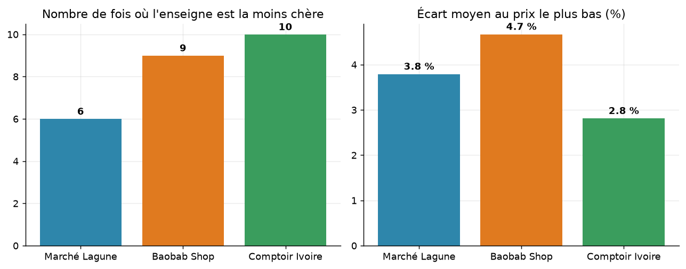
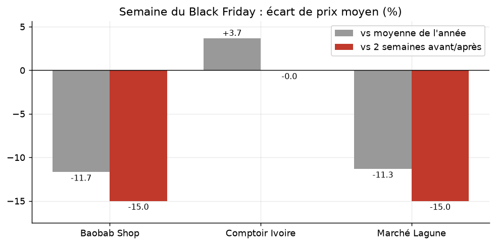

# Analyse comparative de marché — Abidjan

Projet **Data Analysis Python** (L2 Computer Science).
Comparaison des prix d'électronique et d'électroménager entre trois enseignes **fictives** :
Marché Lagune (site marchand), Baobab Shop (application mobile) et Comptoir Ivoire (boutique d'Adjamé).

Le programme collecte trois sources de formats différents (CSV, JSON, Excel), les nettoie, les rapproche
d'un catalogue commun, compare les prix, simule un panier et analyse un an d'historique de prix.

## Sommaire

1. [Ce que demande le projet](#ce-que-demande-le-projet)
2. [Résultats en bref](#résultats-en-bref)
3. [Lancer le projet](#lancer-le-projet)
4. [Structure du projet](#structure-du-projet)
5. [Fichiers générés](#fichiers-générés-dans-resultats)
6. [Choix techniques](#choix-techniques-principaux)
7. [Hypothèses et limites](#hypothèses-et-limites)

## Ce que demande le projet

**Contexte.** Un client veut acheter de l'électronique et de l'électroménager à Abidjan et hésite entre trois
enseignes. Chacune fournit ses prix dans un format différent :

| Enseigne | Fichier | Format |
|---|---|---|
| Marché Lagune | `marche_lagune.csv` | CSV avec séparateur `;` |
| Baobab Shop | `baobab_shop.json` | JSON d'une API |
| Comptoir Ivoire | `comptoir_ivoire.xlsx` | classeur Excel |

Le programme doit **collecter** les trois sources, les **rapprocher** d'un catalogue commun, **comparer** les prix
et **aider à décider** où acheter. L'énoncé complet est dans `data/LISEZ-MOI.md`.

**Fonctionnement.** Le programme est automatique : on le lance une fois, il exécute les 8 étapes
dans l'ordre, affiche les résultats dans le terminal et écrit les tableaux et graphiques dans `resultats/`.
Il n'y a pas de menu et aucune saisie à faire. Les tris et les filtres sont faits par le code
(par exemple le top 3 des écarts est trié par écart décroissant).

| # | Demande de l'énoncé | Où dans le code | Fichier produit |
|---|---|---|---|
| 1 | Chargement des 3 fichiers (CSV, JSON, Excel) dans une même structure | `charger_marche_lagune`, `charger_baobab`, `charger_comptoir` | `offres_nettoyees.csv` |
| 2 | Nettoyage des données et journal des problèmes | `Journal`, `parse_prix`, `controler_avec_historique` | `journal_nettoyage.csv` |
| 3 | Rapprochement de chaque article avec un `produit_id` | `tokens`, `rapprocher`, `rapprocher_tout` | `rapprochement.csv` |
| 4 | Comparatif des produits présents dans au moins 2 enseignes : prix payé, moins cher, écart en FCFA et en % | `calculer_prix_paye`, `construire_comparatif` | `comparatif_prix.csv` |
| 5 | Synthèse : victoires, écart moyen, top 3 des gains | `synthese` | `synthese_enseignes.csv`, `top3_ecarts.csv` |
| 6 | Panier de rentrée : une seule enseigne ou meilleur prix par article | `calculer_panier` | `panier_detail.csv`, `panier_totaux.csv` |
| 7 | Historique : semaine du Black Friday contre moyenne de l'année | `analyser_historique` | `black_friday_*.csv`, `periodes_promotion.csv` |
| 8 | Complexité : temps d'exécution et choix de structures de données | `benchmark` | `benchmark.csv` |

**Règle de l'énoncé.** Un produit en rupture de stock, ou sans prix exploitable, n'est jamais retenu comme
« le moins cher ».

## Résultats en bref

| Enseigne | Fois la moins chère | Écart moyen au prix le plus bas |
|---|---|---|
| Comptoir Ivoire | 10 | 2,8 % |
| Baobab Shop | 9 | 4,7 % |
| Marché Lagune | 6 | 3,8 % |

- **Panier de rentrée** : 477 575 FCFA en achetant chaque article au meilleur prix, contre 484 075 FCFA
  au mieux dans une seule enseigne (Comptoir Ivoire).
- **Black Friday 2025** : environ -15 % chez Marché Lagune et Baobab Shop par rapport aux semaines voisines,
  aucune promotion chez Comptoir Ivoire.




Le détail de la démarche, du nettoyage, du rapprochement et du benchmark est dans [RAPPORT.md](RAPPORT.md).

## Lancer le projet

### Prérequis

- **Python 3.10 ou plus récent.** Pour vérifier : `python --version` (ou `py --version` sous Windows).
  Téléchargement : <https://www.python.org/downloads/>
- **Git**, seulement pour récupérer le projet depuis GitHub. Vérification : `git --version`.
- Environ 50 Mo d'espace libre et aucune connexion Internet une fois les bibliothèques installées.

Version testée : Python 3.12 avec pandas 3.0, numpy 2.5, matplotlib 3.11 et openpyxl 3.1.

### 1. Récupérer le projet

```bash
git clone <url-de-votre-depot>
cd projet_comparatif
```

Si le projet vient d'un fichier zip, décompressez-le, puis ouvrez un terminal **dans le dossier qui contient
`analyse_marche.py`**. Attention : un zip peut créer un dossier dans un dossier, il faut entrer dans le second.

### 2. Créer et activer un environnement virtuel

Windows (PowerShell) :
```powershell
python -m venv .venv
.venv\Scripts\activate
```

macOS / Linux :
```bash
python3 -m venv .venv
source .venv/bin/activate
```

Le terminal affiche alors `(.venv)` au début de la ligne.

### 3. Installer les bibliothèques

```bash
pip install -r requirements.txt
```

### 4. Lancer le programme

```bash
python analyse_marche.py
```

Option : `python analyse_marche.py --no-bench` saute le benchmark (étape 8).

### Ce que vous devez voir

Le terminal affiche les 8 sections numérotées (« 1-2. CHARGEMENT ET NETTOYAGE » jusqu'à « 8. COMPLEXITE »),
puis une dernière ligne du type :

```
TERMINE en 2.4 s — résultats dans .../resultats
```

L'exécution dure quelques secondes. Le dossier `resultats/` contient alors les tableaux CSV et
`resultats/graphiques/` les figures PNG. Les fichiers existants sont écrasés à chaque lancement.

### En cas de problème

| Message | Cause probable | Solution |
|---|---|---|
| `python` n'est pas reconnu | Python absent ou pas dans le PATH | essayer `py` (Windows) ou `python3` (macOS/Linux), sinon réinstaller Python en cochant « Add to PATH » |
| `l'exécution de scripts est désactivée` (PowerShell) | politique de sécurité de Windows | `Set-ExecutionPolicy -Scope CurrentUser -ExecutionPolicy RemoteSigned`, puis réactiver `.venv` |
| `Could not open requirements file` | terminal dans le mauvais dossier | se placer dans le dossier qui contient `requirements.txt` (`dir` ou `ls` pour vérifier) |
| `No module named pandas` | environnement non activé ou bibliothèques non installées | activer `.venv`, puis refaire l'étape 3 |
| `can't open file ... analyse_marche.py` | mauvais dossier | même solution que ci-dessus |
| `FileNotFoundError` sur un fichier de `data/` | dossier `data/` déplacé ou incomplet | il doit contenir les 6 fichiers fournis |

## Structure du projet

```
projet_comparatif/
├── analyse_marche.py      # programme principal (une fonction par étape de l'énoncé)
├── data/                  # données fournies (fictives), à ne pas déplacer
├── resultats/             # tableaux CSV générés
│   └── graphiques/        # figures PNG générées
├── RAPPORT.md             # explications, résultats, choix techniques
├── requirements.txt       # bibliothèques Python nécessaires
├── .gitignore
└── README.md
```

Le programme lit toujours `data/` et écrit toujours dans `resultats/`, quel que soit le dossier d'où on le lance.

## Fichiers générés dans `resultats/`

| Fichier | Contenu |
|---|---|
| `journal_nettoyage.csv` | problèmes détectés dans les données et action menée |
| `rapprochement.csv` | article brut associé à son `produit_id` |
| `offres_nettoyees.csv` | toutes les offres avec prix payé et statut |
| `comparatif_prix.csv` | comparatif des produits présents dans au moins 2 enseignes |
| `synthese_enseignes.csv`, `top3_ecarts.csv` | synthèse |
| `panier_detail.csv`, `panier_totaux.csv` | panier de rentrée |
| `black_friday_*.csv`, `periodes_promotion.csv` | analyse de l'historique |
| `benchmark.csv` | mesures de temps d'exécution |

## Choix techniques principaux

- **Structure commune** : un seul DataFrame `offres`, quelle que soit la source.
- **Prix payé** : Marché Lagune = prix affiché (livraison incluse) ; Baobab = prix + frais de livraison ;
  Comptoir = prix catalogue moins la remise.
- **Rapprochement** : normalisation du texte, score par mots pondérés, tolérance aux fautes de frappe (`difflib`),
  validation croisée avec l'historique.
- **Données douteuses** : prix aberrant corrigé seulement s'il est confirmé par l'historique ;
  prix manquant jamais inventé, l'offre est exclue.
- **Complexité** : index par dictionnaire pour les recherches répétées, `bisect` pour « prix à une date »,
  pandas pour le chargement et les agrégations.

## Hypothèses et limites

- Les frais de livraison Baobab s'appliquent par article.
- Le transport jusqu'à la boutique d'Adjamé n'est pas compté.
- Les données sont fictives et représentent un seul instantané (31/10/2026) plus un historique de prix affichés.